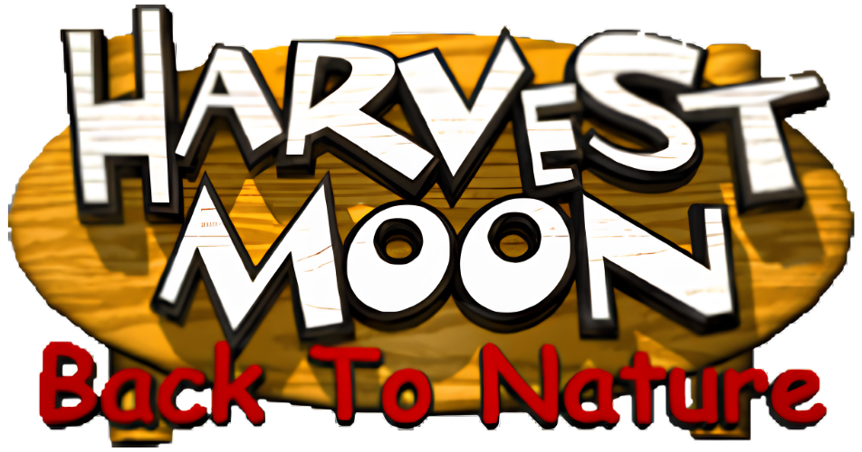

<p align="center">
  
</p>

<h1 align="center">Harvest Moon - Back to Nature Port by Rexaver</h1>

<p align="center"><em>No emulator. No BIOS. The game's own program, translated to C and compiled
natively - sharper, with co-op and quality-of-life options.</em></p>

An unofficial, native version of *Harvest Moon: Back to Nature* (PlayStation, USA, `SLUS-01115`) for
Windows, Linux and Android, made by **static recompilation**: the game's original PlayStation program
was translated ahead of time into C and compiled into an ordinary native program. No emulator runs the
game and no PlayStation BIOS is involved; the console's hardware (graphics and sound chips, CD drive,
controller port, memory card, geometry coprocessor, timers) is reimplemented natively.

**This repository holds the ready-to-play builds only.** The port's source code stays in a private
repository: what is here is a README, its logo and the release assets, never code, never history and
never a build script.

## Download

Open [Releases](../../releases/latest) and take the asset for your platform. Every asset has its
SHA-256 published beside it in a `.sha256` file.

| Asset | What it is for |
|---|---|
| `HarvestMoonBTN-Windows-x64.zip` | The game folder for Windows x64: unpack it anywhere and open `HarvestMoonBTN-Launcher.exe`. |
| `HarvestMoonBTN-Linux-x64.zip` | The game folder for Linux x64: unpack it anywhere and open `launcher.pyw` (or run `./HarvestMoonBTN` directly). Needs SDL2, which most distributions install already. |
| `HarvestMoonBTN-Android-<version>.apk` | The Android package: install it on a phone and open the app. |
| `HarvestMoonBTN-Launcher.exe` | The launcher on its own, for an install you already have: the **Update** button replaces the copy in the game folder with it. |
| `<asset>.sha256` | The digest of the asset beside it, as `sha256sum` writes it: `<hex>  <name>`. |

Each game folder is the whole game - the executable, the launcher and `HarvestMoonBTN.pak` with the
game's own graphics, music and text - so no disc image, no emulator and no BIOS are needed to play.

### Checking a download

The launcher already does this for you: **Download and play** and **Update** fetch the published
`.sha256` and refuse a file that does not match it, before they unpack or replace anything. To check
one by hand:

```sh
sha256sum -b HarvestMoonBTN-Linux-x64.zip           # Linux
```
```
certutil -hashfile HarvestMoonBTN-Windows-x64.zip SHA256    :: Windows (cmd)
```

The printed digest must equal the one in the `.sha256` file of the same name.

## What is in the build

### The original game

The same game logic, graphics, music and timing: the original 320x240 picture, the original NTSC rate
(59.29 fps, and its speed-dependent gameplay with it), and the PlayStation memory card format. Two
bugs of the original are fixed: the farm score now reaches 100%, and the hothouse eggplant has the
right colours when carried.

### Sharper graphics

- **Internal resolution** 2-4x (up to 8x with the Vulkan renderer), with perspective-correct textures.
- **PGXP**: precise 3D vertex positions, so models no longer wobble - with the thin cracks it opens
  between models closed again.
- **Widescreen** 16:9, 16:10 and 21:9: a wider 3D view, with the HUD and 2D objects keeping their
  shape and the title screen and menus filling the screen.
- **60 fps camera**: the camera and the scenery move every VBlank while the game keeps its own 30 Hz
  logic.
- **Texture packs** and **redrawn portraits**: replacement images in `textures/` and
  `textures/portraits/` next to the game.
- **Display**: window or fullscreen, sharp-bilinear, sharp or smooth scaling, 4:3 or square pixels,
  screenshots, and an optional frame-rate readout in the game's own font.

### Co-op

- **Local co-op**: two farmers on one PC, each in a window of their own (experimental). Farmer 2 uses
  a second controller or the numeric keypad, takes tools from the tool chest and trades with farmer 1
  by standing in front of them and pressing Cross. Farmer 2 can also go into buildings alone.
- **Online co-op**: two players, each on their own PC, in one game over TCP. Both need the same build
  version, which the window title shows; the host's settings, mods and cheats count for both, and the
  guest's own memory cards are never touched.

### Time savers

All of them optional, all of them original behaviour when switched off: shorter loading
(`fastcd`), quicker menus and shorter fades (`quickui`), faster dialogue text (`textspeed`), saving
and loading without the memory card slot menu (`autoslot`), no waiting while a card is read or
written (`fastcard`), cutscenes at full speed while START is held (`skipscenes`), hold-to-fast-forward
(`fastforward`), and a CPU speed up to 400% (`overclock`) so the game stops dropping frames when a lot
is going on - video, sound and timing stay the same.

### Mods and cheats

Four mods, off unless switched on: the cabinet opens in the first house, walking through crops, a
stamina and tiredness panel the game never shows, and buying food in bulk. Cheats (money, endless
stamina, a stopped clock, the biggest rucksack, materials and top-level tools) are on the launcher's
Cheats page and in-game; what a save made with them contains stays in the save.

### Saves

Memory cards as the PlayStation writes them: `saves/card1.mcd`, a standard 128 KB raw card image that
emulators such as DuckStation, ePSXe and PCSX read and write too, so an existing save can be brought
in and taken back out. Four cards (F1-F4) hold three diaries each. If the game folder is not
writable, the cards live in `%APPDATA%\Rexaver\HarvestMoonBTN` (Windows) or
`~/.local/share/Rexaver/HarvestMoonBTN` (Linux).

### The launcher

Every setting has a row on one of its pages - video, game, mods, keyboard, controller, local and
online co-op, cheats - and it writes `hmbtn.ini` next to the game. It starts the game, shows whether
the data pack is found and intact, downloads the game when the folder has none, and updates itself
from a newer release of this repository.

## Settings that apply without a restart

The game re-reads `hmbtn.ini` twice a second and takes what it can use on a running game: the cheats,
the time savers (`overclock` included), scaling, aspect, the frame-rate readout, window scale and
fullscreen, every keyboard and controller binding, and the on-screen gamepad. The rest is chosen
when the game starts and the launcher marks those rows **Restart the game to apply**: `renderer`,
`upscale`, `drawthreads`, `pgxp` with `crackfix`, `perspective`, `interp`, `texturepack`, `portraits`,
`dumptextures`, `widescreen`, `savedir`, `p2view_upscale`, `record` and `split`.

## Credits and legal

This is an unofficial fan project, not affiliated with or endorsed by Marvelous Inc., Natsume Inc.,
Victor Interactive Software or Sony Interactive Entertainment. *Harvest Moon* and *Back to Nature*
are trademarks of their respective owners.

The port's own code - the recompiler, the runtime and the launcher - is MIT-licensed, copyright
Rexaver. That licence covers the port's code only, and this repository publishes no code. The game's
data in these builds (graphics, music, text) and the translated game program are derived from
*Harvest Moon: Back to Nature* and are not this project's to license; they remain the property of
their copyright holders, and the folders are for personal use.

The port uses SDL2 (zlib license), and the launcher and the phone's settings screen are lettered in
Silkscreen (SIL Open Font License 1.1). The Vulkan renderer includes parallel-psx (ISC/MIT), volk
(MIT), SPIRV-Cross and the Vulkan headers (Apache-2.0). The launcher exe is made with PyInstaller.
